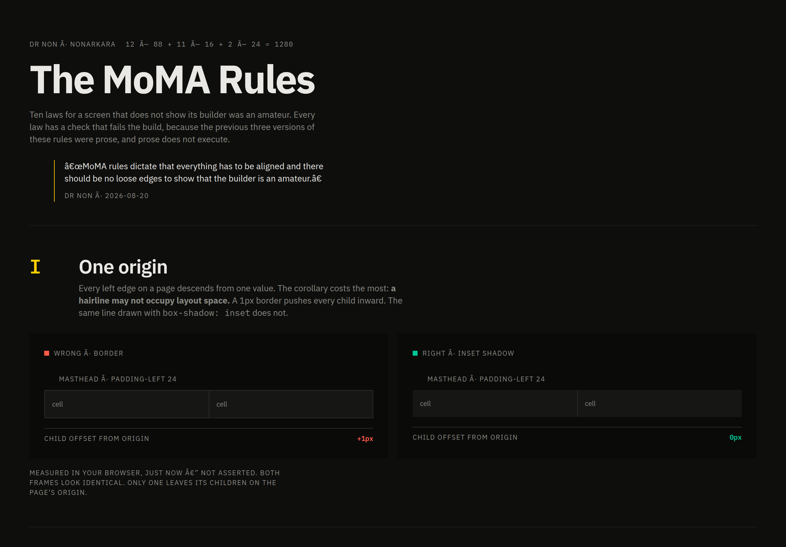
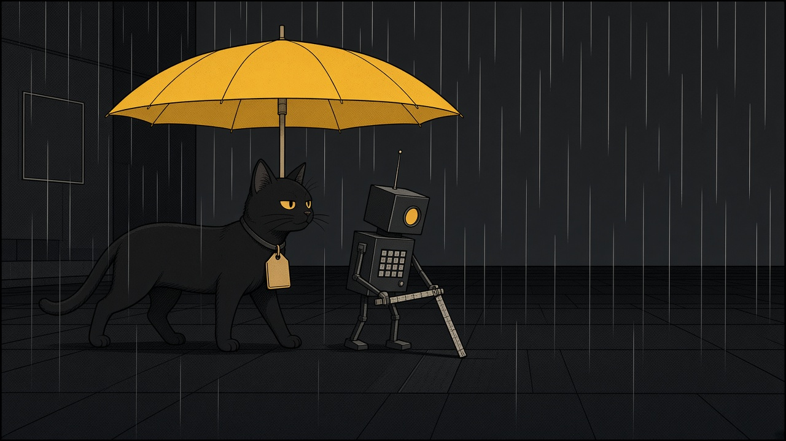

[English](README.md) · 简体中文 · [ไทย](README.th.md)

# MoMA 规则

十条版式法。每条都带着能让构建失败的检查。前三次写成散文，页面过一阵就漂回去。这一次数字放在 `lint/scale.mjs` 里，散文的职责只是把这些数字说对，并且被对着代码核对。



`examples/index.html`，无头 Chrome，视口 1280×900，`data-theme="dark"`，IBM Plex Sans 与 IBM Plex Mono 已加载，2026-10-12。两个框是页面在量自己的子元素。[打开这一页。](examples/index.html)

这张图不是 1280 那条公式本身。在这个视口里，页面边框盒宽 **1232px**，左右各垫 24px，内宽 **1184px**。标题算出来是 **64px / 65.28px**。两件事都写在下面：检查器看不见的地方。

> 「东西都得对齐，不能露出毛边，不然一看就知道是外行做的。」
>
> 这是对 Dr Non 2026-08-20 英文原句的转述。原句是：MoMA rules dictate that everything has to be aligned and there should be no loose edges to show that the builder is an amateur.

[十条法](LAWS.zh-CN.md) · [建造的方法](BUILDER.zh-CN.md) · [网格，推出来的](docs/grid.zh-CN.md)

## 一页纸，四个数

数字来自 `lint/scale.mjs`。`node lint/self-check.mjs` 会把它们再推一遍。

| | |
|---|---|
| 栏宽、槽、页边 | 88、16、24 |
| 内容宽 | 12 × 88 + 11 × 16 = **1232** |
| 页宽 | 1232 + 2 × 24 = **1280** |
| 间距 | `0  4  8  12  16  20  24  32  40  48  64  80  96  120  160` |
| 字号 / 行距 | 11/16、14/20、32/36 |
| 允许的 `minmax` 下限 | 192、296、400、608 |
| 发丝线、圆角 | 1px，而且不得占布局。圆角为 0。真正的圆除外。 |

第五条法在 2026-09-10 之前写的是 160 / 220 / 280。这三个数正是 `scale.mjs` 拿来举例、说明什么会拆掉 12 栏页面的反例。法条现在写的是跨栏宽度。

## 真正会跑的

| 命令 | 它读什么 |
|---|---|
| `npm run lint` | `node lint/moma-lint.mjs .`。静态规则。若有基线，就对着基线。 |
| `npm run check` | 只跑 `node lint/self-check.mjs`。它从不打开 `LAWS.md`。 |
| `node lint/laws-check.mjs` | 用英文 [LAWS.md](LAWS.md) 去对 `lint/scale.mjs`。没有 npm 脚本包着它。 |
| 把 [`audit/near-miss.browser.js`](audit/near-miss.browser.js) 贴进控制台 | 排好版之后的边。没有运行器，也不进 CI。 |

CI 是 [`.github/workflows/moma.yml`](.github/workflows/moma.yml)。push 和 pull request 时跑三件：`node lint/moma-lint.mjs examples --strict`、`node lint/self-check.mjs`、`node lint/laws-check.mjs`。

静态检查能报出的规则：`spacing-scale`、`grid-density`、`type-scale`、`radius-zero`、`hairline`。

贴进控制台才能报的：`near-miss`、`orphan-grid`、`ragged-row`。

`origin-mechanism` 写在第一条法里，并标明 **尚未实现**。`laws-check` 接受这一点，因为法条自己这么写了。

## 检查器看不见的

构建可以是绿的，页面照样是错的。下面是 2026-10-12 对着源码和上面这张渲染核对过的缺口。

- **第一条法的静态检查不存在。** 代价最大的那条推论——发丝线不得占布局——仍是一个愿望。演示页的引语自己就是 `border-left: 1px`。`hairline` 允许这个粗细。CI 里没有谁问这条线有没有把字推开。
- **四条法只是一段要贴进控制台的脚本。** 第一、四、六、七条不进 CI。差 1–6px 的边、填不满的格子、一行里高低不齐的单元格，都要等浏览器排完版才存在。
- **`type-scale` 只认光秃秃的 `font-size: Npx`。** 页眉标题是 `clamp(32px, 7vw, 64px)`，`line-height: 1.02`。在 1280×900 下就是 64px 对 65.28px。同一天对 `examples/` 做严格检查，报告 0 条违规。`laws-check` 能从 `micro 11/16` 里捕获行距，却从不拿它去比 `LEADING`。
- **第八条法仍在跟自己吵架。** 正文引用 MoMA 的 2px、3px 强调线。检查器拒绝 1px 以外的任何粗细。这个矛盾是故意留着的。第五条的矛盾已经合上。
- **检查器不读 `.mjs`。** 它只走 `.tsx`、`.ts`、`.jsx`、`.js`、`.css`、`.scss`、`.html`。检查器不检查自己。
- **没有 `npm run audit`。** [BUILDER.md](BUILDER.md) 里曾经有一句说有。

完整的表，包括第五条法曾经让「守法的页面」构建失败的那一天，在 [docs/law-to-check.zh-CN.md](docs/law-to-check.zh-CN.md)。

第十条——一个数在一块屏幕上只说一次，层级跟着读者来找的那个东西走——没有检查。它放在最后，是为了让前九条花掉机器的注意力，把这一条留给人。

## 用到已经很脏的代码上

不要一上来就开 `--strict`。一天之内就会被关掉。用棘轮。

```bash
node lint/moma-lint.mjs src --update-baseline   # 记下今天的债
node lint/moma-lint.mjs src                     # 只在新的违规上失败
```

`--update-baseline` 拒绝写下更大的一份。债只能减，不能增。本仓库没有 `.moma-baseline.json`。演示页在检查器看得见的静态规则下是干净的；上一节写的那些，它不干净。

## 接着读

封面、法条、方法、网格、字体说明、审计，以及线为什么对不齐的那份记录，有英文、简体中文和泰文。检查器只读英文法条。

| | |
|---|---|
| [LAWS.zh-CN.md](LAWS.zh-CN.md) | 十条法，每条带着它的检查 |
| [BUILDER.zh-CN.md](BUILDER.zh-CN.md) | 法上面的那层方法。真要动手，先读这个。 |
| [docs/grid.zh-CN.md](docs/grid.zh-CN.md) | 1280 的页是怎么推出来的 |
| [docs/typography.zh-CN.md](docs/typography.zh-CN.md) | 读者、文本、文种。第三条法不保证其中任何一件。 |
| [docs/why-lines-dont-align.zh-CN.md](docs/why-lines-dont-align.zh-CN.md) | 2026-09-08 的测量。这些法是为了回答它才写的。 |
| [docs/law-to-check.zh-CN.md](docs/law-to-check.zh-CN.md) | 每一条法，对着声称要执行它的检查 |

下面这些仍是英文，因为它们是测量记录：

[docs/moma-study.md](docs/moma-study.md) · [docs/moma-vs-us.md](docs/moma-vs-us.md) · [docs/styles/luggage-tag.md](docs/styles/luggage-tag.md) · [docs/design-slop-field-guide.md](docs/design-slop-field-guide.md) · [docs/deck/README.md](docs/deck/README.md) · [docs/proposals/v2-architecture.md](docs/proposals/v2-architecture.md)

v2 是提案，没有生效。审计要求先把地板补上，再加层。

这一版封面和另外两种语言数字相同、缺口相同，但不是逐行对译。`lint/laws-check.mjs` 不读中文，也不读泰文。数字若有出入，以英文 `LAWS.md` 和 `lint/scale.mjs` 为准。

## 来源

- 开篇那句是 Dr Non 的，2026-08-20，保存在 [LAWS.md](LAWS.md)。上面的中文是这一版的转述。
- Dieter Rams 的十条原则，是那份文件用来打的比方。这里的法不是那些原则。三档字号是更严的选择，[docs/moma-vs-us.md](docs/moma-vs-us.md) 写明了。
- 生产环境的数字——86 个间距值、40.1% 不在 4px 网格上、原点在 22px、124 条边对 62 条边、856 对近失的边——来自 2026-09-08 对 day.nonarkara.org 的测量，写在 [docs/why-lines-dont-align.md](docs/why-lines-dont-align.md)。这一版没有重测那个站点。
- MoMA 自己的页面在做什么，见 [docs/moma-study.md](docs/moma-study.md)。依据是生产 CSS 和藏品记录，不是设计博客。
- 字，作为读者的问题：Robert Bringhurst，《The Elements of Typographic Style》，第二版，1997 年印次，选读第 17–33 页，以及第 6 章第 93–117 页。范围、许可、以及「没有通读全书」这件事，写在 [docs/typography.md](docs/typography.md)。本仓库没有该书的扫描件，也不暗示作者背书。
- 同一套读法是可携带的技能 [skills/bringhurst-contextual-type/SKILL.md](skills/bringhurst-contextual-type/SKILL.md)，以及 [Palette](https://github.com/Nonarkara/palette) 的阅览室：[colors.nonarkara.org/reading#typography](https://colors.nonarkara.org/reading#typography)。这张封面在 Markdown 做得到的地方跟上那份契约：一件实物，没有徽章墙，没有渐变，没有用表情符号充当标记。
- 演示页请求 IBM Plex Sans 和 IBM Plex Mono。标本是在这两个家族已加载的情况下渲染的。
- `package.json` 把仓库标为 `UNLICENSED`、私有。字体说明里的 MIT 只覆盖那则说明，不覆盖本仓库的其余部分。

---



书末的一幅。一只猫，一把伞，一个小机器人。它不是法条的图解。地面是网格，项圈是行李牌，有一块砖没有和别的砖坐齐。为这一版而作，不是从印好的漫画上扫下来的。
